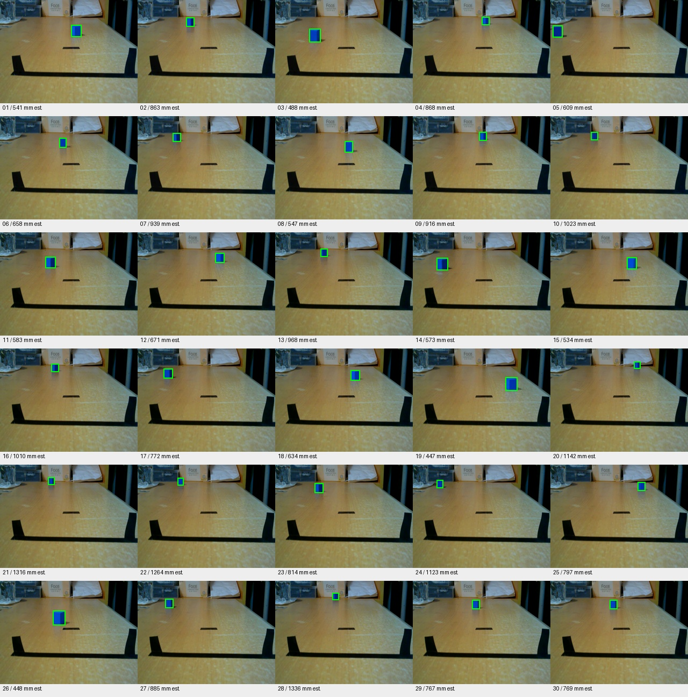
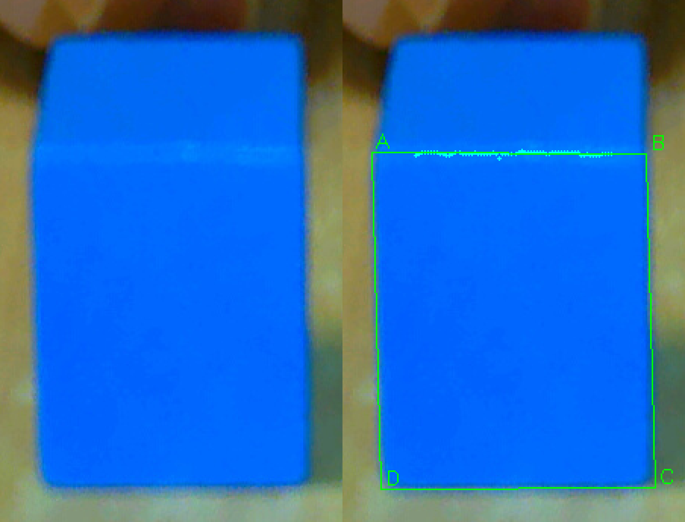
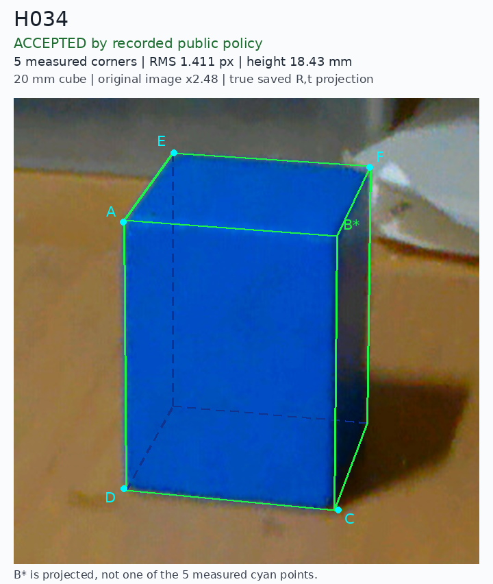

# 思达｜视觉追踪与自主抓取机器人

基于 **K230、MSPM0 与六轴机械臂** 的移动抓取机器人。围绕20 mm蓝色方块，实现语音触发、视觉追踪、底盘接近、停车定位和机械臂抓取，并已演示目标重搜与夹取失败后的重试。

**运行流程：** 语音触发 → 视觉接近 → 停车定位 → 机械臂抓取。

**技术关键词：** 嵌入式视觉 · 几何定位与坐标变换 · 编码器闭环 · 差速底盘 · 机械臂运动学 · 车臂协同。

## 粗定位演示视频

[查看视频](videos/blue-cube-coarse-localization.mp4) · [原文件播放／下载](https://raw.githubusercontent.com/WHU-SAS/aic-robot/main/docs/showcase/videos/blue-cube-coarse-localization.mp4)

蓝块在桌面上移动时，画面逐帧显示检测框、像素中心、蓝色面积，以及摄像头垂足到方块底面中心估计点的桌面距离与虚线。

约 **9.2秒，原速**，由此前录像的两段桌面移动片段剪接而成。**K230采集原片，电脑后期逐帧检测并叠加数据，并非板端实时录屏。** 毫米距离是桌面接触条件下的粗估计，不作为机械臂精定位坐标。

## 精选图片

共7张图片，按“远距离检测与跟踪 → 近距离几何定位 → 停车区域”的顺序展示。

### 1. 远距离多位置检测

同一蓝块在不同远近、左右位置的30张照片中进行色块检测，展示目标尺度变化时的框选结果。此图为历史PC离线分析总览，标注距离是粗估计，不是尺量真值，也不代表当前版本的整体准确率。

### 2. 蓝块识别与粗定位

从K230图像中提取目标框、像素中心和蓝色面积，并估计桌面上的目标距离，为底盘接近提供依据。**此图为原片的电脑离线分析标注，非板端实时录屏；毫米数为粗估计。**

### 3. 目标重新入画

展示目标重新入画后的检测与距离标注。此图同样来自电脑离线分析。

### 4. 近距离物理面定位

接近目标后，从整体色块检测切换到物理面与边缘定位，为停车校验和机械臂抓取提供更准确的几何信息。此图为历史算法诊断叠图，展示侧面与棱线的提取。

### 5. 高光棱线与物理面提取

左侧为原图局部，右侧为实际测量叠图。利用方块两面交界处的高光线提取棱线，再结合其余边界定位物理侧面，改善正视时两面蓝色接近、难以分开的情况。青色点为棱线测量采样，绿色线与A～D标记展示拟合侧面；这是离线算法诊断图。

### 6. 立方体模型与三维姿态拟合

利用五个可见测量角点和已知20mm立方体模型求解姿态，再把模型投回图像检查几何一致性。青色角点来自测量，绿色为模型投影，深蓝虚线表示不可见的模型边；B*由模型推算，并非额外测得的角点。图中像素重投影误差衡量模型与图像的吻合程度，不等同于毫米定位误差或实际夹取精度。

### 7. 停车区域设计

将相机视野与机械臂可达范围结合，定义停车接收区域。绿线展示区域边界，被方块遮挡的部分以虚线表示，红点示意方块底面中心。此图使用历史窗口配置，用于解释设计思路；当前参数以运行配置为准。

图片来自不同开发阶段，不构成同一次运行的连续记录；定位精度、重复运行稳定性与成功率仍需单独统计。

## 用于项目展示

可以直接复制 [项目展示片段](profile-snippet.md)，其中使用GitHub图片地址，适合用于项目页面、汇报材料或仓库README。需要自行排版时，可从 `images/` 选择图片；建议以蓝块识别截图配合停车区域图展示项目，技术细节可补充高光棱线对照、立方体模型拟合。

图片与视频来源、文件尺寸和SHA256见 [素材清单](sources.json)。本目录仅公开精选副本，原始实验归档继续保留本机。素材适用仓库的[版权与权限说明](../../LICENSE)。
