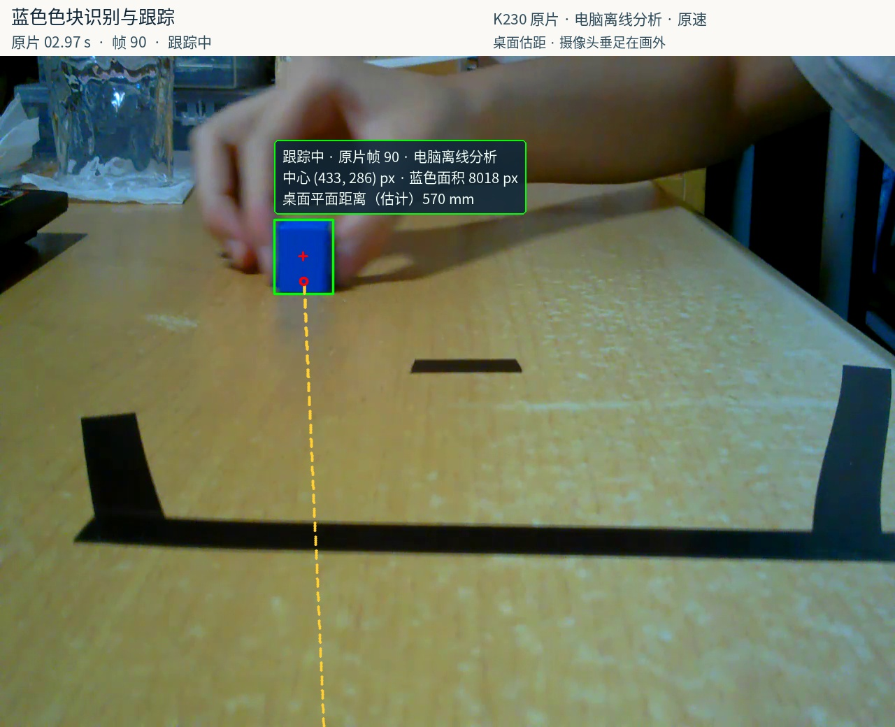
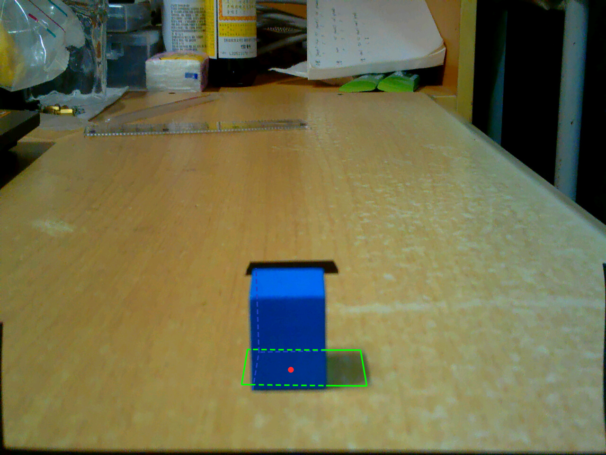
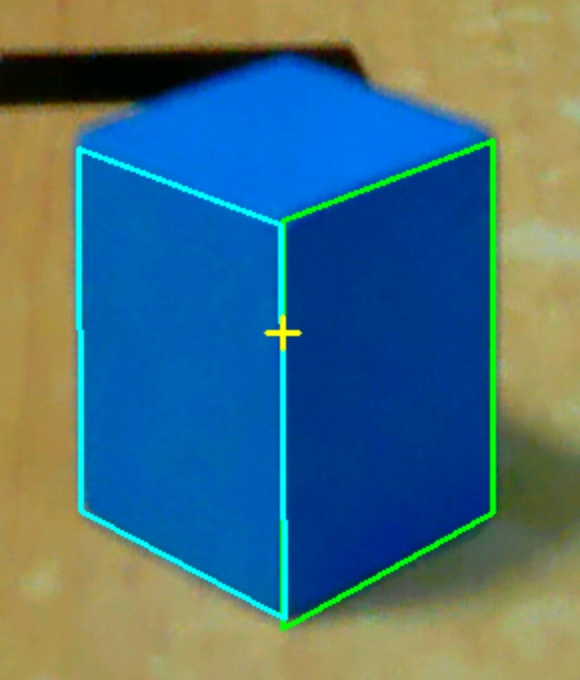
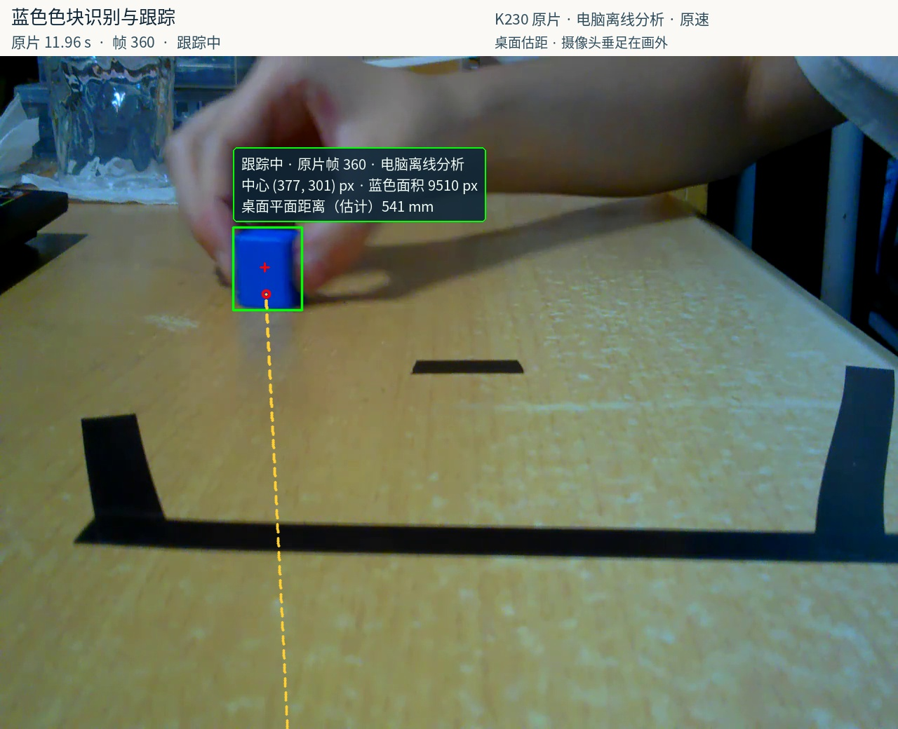

# 思达｜视觉追踪与自主抓取机器人

基于 **K230、MSPM0 与六轴机械臂** 的移动抓取机器人。围绕20 mm蓝色方块，实现语音触发、视觉追踪、底盘接近、停车定位和机械臂抓取，并已演示目标重搜与夹取失败后的重试。

**技术关键词：** 嵌入式视觉 · 相机标定与坐标变换 · 编码器闭环 · 差速底盘 · 机械臂运动学 · 车臂协同。

## 精选图片

### 1. 蓝块识别与粗定位

从K230图像中提取目标框、像素中心和蓝色面积，并估计桌面上的目标距离，为底盘接近提供依据。**此图为原片的电脑离线分析标注，非板端实时录屏；毫米数为粗估计。**

### 2. 停车区域设计

将相机视野与机械臂可达范围结合，定义停车接收区域。绿线展示区域边界，被方块遮挡的部分以虚线表示，红点示意方块底面中心。此图使用历史窗口配置，用于解释设计思路；当前参数以运行配置为准。

### 3. 近距离物理面定位

接近目标后，从整体色块检测切换到物理面与边缘定位，为停车校验和机械臂抓取提供更准确的几何信息。此图为历史算法诊断叠图，展示侧面与棱线的提取。

### 4. 目标重新入画

展示目标重新入画后的检测与距离标注。此图同样来自电脑离线分析。

图片来自不同开发阶段，不构成同一次运行的连续记录；定位精度、重复运行稳定性与成功率仍需单独统计。

## 用于个人简介

可以直接复制 [个人简介片段](profile-snippet.md)，其中使用GitHub图片地址，适合粘贴到个人主页或GitHub Profile README。需要自行排版时，可从 `images/` 选择图片；建议以蓝块识别截图配合停车区域图展示项目，技术细节再补充物理面定位截图。

原图来源、文件尺寸和SHA256见 [素材清单](sources.json)。本目录仅公开精选副本，原始实验归档继续保留本机。素材适用仓库的[版权与权限说明](../../LICENSE)。
