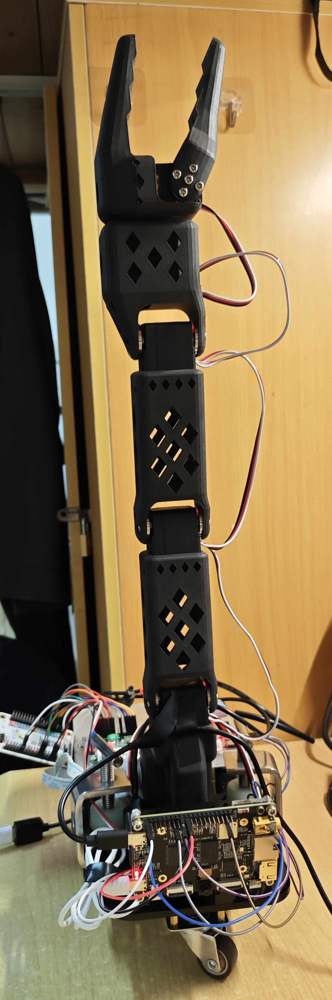
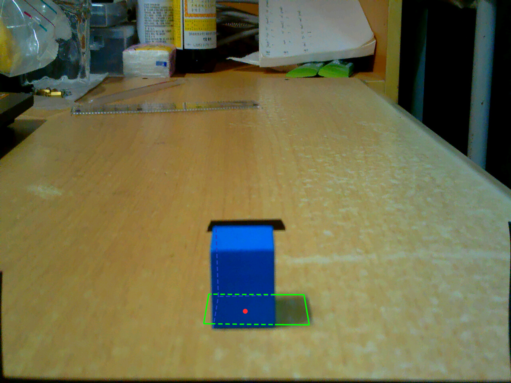

### 思达｜视觉追踪与自主抓取机器人

基于K230、MSPM0与六轴机械臂，围绕20 mm蓝色方块，实现语音触发、视觉追踪、底盘接近、停车定位及抓取，并已演示目标重搜和夹取失败重试。

**技术方向：** 嵌入式视觉、相机标定、编码器闭环控制、机械臂运动学与车臂协同。

  
  

[项目仓库](https://github.com/WHU-SAS/aic-robot) · [更多图片与说明](https://github.com/WHU-SAS/aic-robot/tree/main/docs/showcase) · [实物抓取演示（2倍速）](https://github.com/user-attachments/assets/8727d0c5-af14-46ac-8d45-5f98477f9e53)

图片包含开发实物及历史示意，重复运行稳定性与精度仍在验证。
